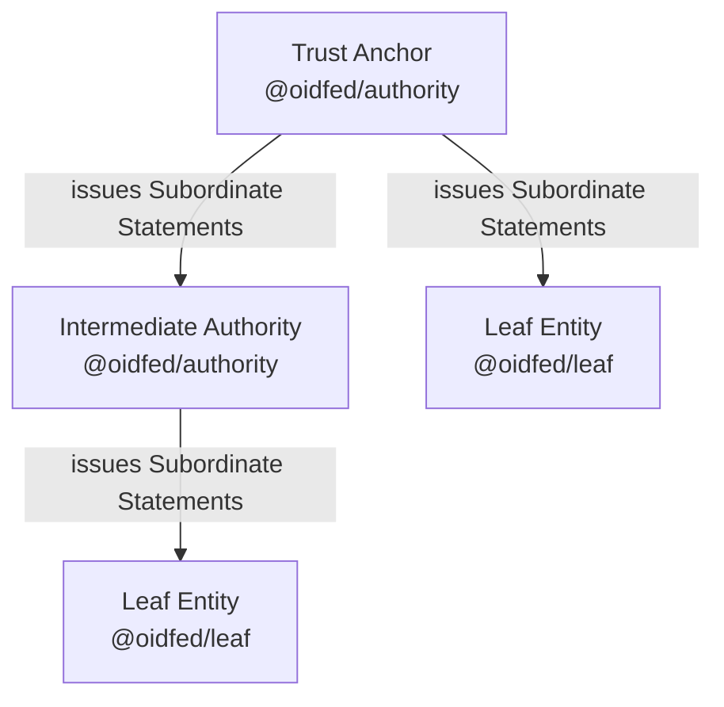

# oidfed

OpenID Federation's protocol-independent trust framework for JavaScript and TypeScript. Build Trust Anchors, Intermediate Authorities, and Leaf Entities that publish signed Entity Statements, discover and validate trust chains, apply metadata policies, and issue or verify Trust Marks.

The four libraries use standard Web APIs, including `Request`, `Response`, and Web Crypto. The same package test suite runs on Node.js, Deno, Bun, workerd (the Cloudflare Workers runtime), Electron, and Chromium.

Protocol-specific roles can add metadata and handlers to those entities. `@oidfed/oidc` supplies the OpenID Connect and OAuth integrations.

## Implemented specifications and features

| Specification | Implementation |
|---|---|
| [OpenID Federation 1.1](https://openid.net/specs/openid-federation-1_1.html) | Entity Configuration and Subordinate Statement signing and verification; trust-chain discovery and validation; metadata policies and constraints; Trust Mark issuance, validation, status, listing, and delegation; federation endpoints. |
| [OpenID Federation for OpenID Connect 1.1](https://openid.net/specs/openid-federation-connect-1_1.html) | OIDC and OAuth entity metadata, with automatic and explicit OIDC client registration. |
| [OpenID Federation 1.0](https://openid.net/specs/openid-federation-1_0.html) | The combined trust framework and OIDC/OAuth functionality from which the two 1.1 specifications were separated. |
| [Extended Subordinate Listing 1.0, Draft 03](https://openid.net/specs/openid-federation-extended-listing-1_0.html) | Opaque `from` / `next` pagination, repeated Trust Mark type filters, audit timestamps, and selected Subordinate Statement claims. |

The two Federation 1.1 specifications separate the functionality defined in 1.0 and introduce no new functionality. Optional endpoints and registration features require the corresponding metadata and configuration; see the package documentation below.

See the [OpenID Federation ecosystem](https://oidfed.com/ecosystem/) for related specifications, implementations, and deployment examples.

## Packages

| Package | Use it for |
|---|---|
| [`@oidfed/core`](docs/packages/core.md) | Entity Statements, trust-chain resolution and validation, metadata policies, constraints, Trust Marks, and federation key providers. |
| [`@oidfed/authority`](docs/packages/authority.md) | Trust Anchors and Intermediates: subordinate management, statement issuance, and federation endpoint handlers. |
| [`@oidfed/leaf`](docs/packages/leaf.md) | Leaf Entity Configurations and trust-chain discovery. |
| [`@oidfed/oidc`](docs/packages/oidc.md) | OIDC and OAuth roles composed into an authority or leaf, with federation registration for OPs and RPs. |
| [`@oidfed/cli`](docs/tools/cli.md) | Inspect entities, resolve trust chains, verify statements, and check federation endpoints from the terminal. |

All four libraries include TypeScript types. The CLI runs on Node.js.



Arrows show which authority attests to each subordinate. Protocol roles, including OIDC/OAuth roles, can be composed into these entities independently of their position in the hierarchy.

## Usage

A Trust Anchor exposes a self-signed Entity Configuration and endpoints for fetching and listing its subordinates:

```ts
import { MemoryStorageAdapter, TrustAnchor } from "@oidfed/authority";
import { generateSigningKey, MemoryFederationKeyProvider } from "@oidfed/core";

const { privateKey } = await generateSigningKey("ES256");

const authority = new TrustAnchor({
  entityId: "https://ta.example.org",
  keyProvider: MemoryFederationKeyProvider.fromJWK(privateKey),
  storage: new MemoryStorageAdapter(),
  metadata: {
    federation_entity: {
      federation_fetch_endpoint: "https://ta.example.org/fetch",
      federation_list_endpoint: "https://ta.example.org/list",
      federation_extended_list_endpoint: "https://ta.example.org/list-extended",
    },
  },
});

export const handleRequest = (request: Request) => authority.handleRequest(request);
```

Mount `handleRequest` in your HTTP server or worker and serve the Entity Identifier over HTTPS. Routes follow the advertised endpoint paths. The Entity Configuration is available at `https://ta.example.org/.well-known/openid-federation`.

This example uses temporary in-memory keys and storage. For deployment, supply a durable federation key provider and a `StorageAdapter`. The [wiring guide](docs/guide/wiring-guide.md) covers HTTP integration, subordinate enrollment, and OP/RP registration. The [storage guide](docs/guide/storage-guide.md) defines persistence, transaction, replay, and cache contracts.

Use a Trust Anchor for an authority without superiors, an Intermediate for an authority with at least one superior, and a Leaf for a participant that does not issue Subordinate Statements. These choices describe the federation hierarchy independently of the application protocol. Trust-chain validation requires a configured set of trusted anchors and their public federation keys.

For OIDC/OAuth applications, compose the appropriate [protocol role](docs/packages/oidc.md) into the parent entity. Keep federation signing keys separate from protocol keys used for Request Objects and client assertions.

## Example federation

The [example federation repository](https://github.com/Dahkenangnon/fed-oidfed-com) demonstrates six topologies, including hierarchical and multi-anchor federations, cross-federation trust, constraints, and metadata policies. Browse the [demo federation](https://fed.oidfed.com) with the [Explorer](https://explore.oidfed.com).

## Documentation and tools

- [Documentation](docs/README.md): package APIs and integration guides.
- [CLI](docs/tools/cli.md): command-line inspection and validation.
- [Explorer](https://explore.oidfed.com): inspect Entity Configurations, trust chains, metadata policies, and Trust Marks in the browser.
- [Learn OpenID Federation](https://learn.oidfed.com): an interactive course on federation concepts and protocol flows.
- [Security policy](SECURITY.md): vulnerability reporting.
- [Contributing](CONTRIBUTING.md): repository setup, development, and verification commands.
