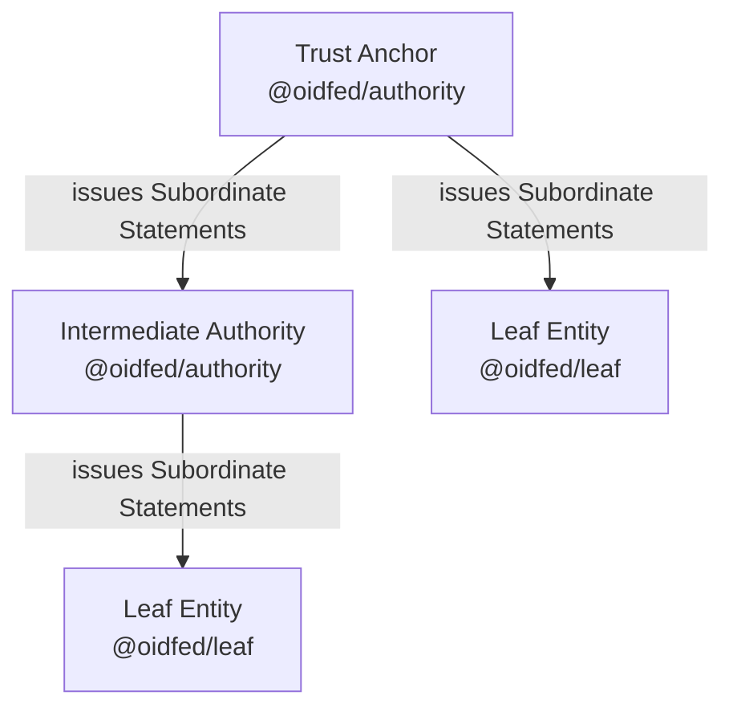

# oidfed

OpenID Federation's protocol-independent trust framework for JavaScript and TypeScript. Build Trust Anchors, Intermediate Authorities, and Leaf Entities that publish signed Entity Statements, discover and validate trust chains, apply metadata policies, and issue or verify Trust Marks.

The libraries use standard transport APIs such as `Request` and `Response`. Applications supply crypto operations and signing custody through explicit contracts, using Web Crypto or their chosen backend. The same package test suite runs on Node.js, Deno, Bun, workerd (the Cloudflare Workers runtime), Electron, and Chromium.

Protocol-specific roles add metadata and handlers to those entities. `@oidfed/oidc` supplies OpenID Connect and OAuth integrations; `@oidfed/wallet` supplies Wallet Provider, Credential Issuer, and Credential Verifier roles.

## Implemented specifications and features

| Specification | Implementation |
|---|---|
| [OpenID Federation 1.1](https://openid.net/specs/openid-federation-1_1.html) | Entity Configuration and Subordinate Statement signing and verification; trust-chain discovery and validation; metadata policies and constraints; Trust Mark issuance, validation, status, listing, and delegation; federation endpoints. |
| [OpenID Federation for OpenID Connect 1.1](https://openid.net/specs/openid-federation-connect-1_1.html) | OIDC and OAuth entity metadata, with automatic and explicit OIDC client registration. |
| [OpenID Federation 1.0](https://openid.net/specs/openid-federation-1_0.html) | The combined trust framework and OIDC/OAuth functionality from which the two 1.1 specifications were separated. |
| [Extended Subordinate Listing 1.0, Draft 03](https://openid.net/specs/openid-federation-extended-listing-1_0.html) | Opaque `from` / `next` pagination, repeated Trust Mark type filters, audit timestamps, and selected Subordinate Statement claims. |
| [Subordinate Events Endpoint 1.0, Draft 01](https://openid.net/specs/openid-federation-subordinate-events-1_0.html) | Signed subordinate event history, transactional lifecycle recording, and verified event retrieval. |
| [Entity Collection Endpoint 1.0, Draft 01](https://openid.net/specs/openid-federation-entity-collection-1_0-01.html) | Discovery of direct and indirect subordinates, with filters, informational metadata, language selection, and opaque pagination. Federation Entities and independent applications can serve the endpoint. |
| [Wallet Architectures 1.0, Draft 05](https://openid.net/specs/openid-federation-wallet-1_0-05.html) | Provider, issuer, and verifier roles, federation-backed request checks, Wallet Attestations, and credential-verification integrations. |

The two Federation 1.1 specifications separate the functionality defined in 1.0 and introduce no new functionality. Optional endpoints and registration features require the corresponding metadata and configuration; see the package documentation below.

See the [OpenID Federation ecosystem](https://oidfed.com/ecosystem/) for related specifications, implementations, and deployment examples.

## Packages

| Package | Use it for |
|---|---|
| [`@oidfed/crypto`](docs/api/crypto/README.md) | Portable crypto engines, signing custody, keyring snapshots and compact JWS utilities; independent of existing host crypto APIs. |
| [`@oidfed/core`](docs/api/core/README.md) | Entity Statements, trust-chain resolution and validation, metadata policy, Trust Marks, Entity Collection, and the shared storage contract. |
| [`@oidfed/authority`](docs/api/authority/README.md) | Trust Anchors and Intermediates: subordinate management, statement issuance, and federation endpoint handlers. |
| [`@oidfed/leaf`](docs/api/leaf/README.md) | Leaf Entity Configurations and trust-chain discovery. |
| [`@oidfed/oidc`](docs/api/oidc/README.md) | OIDC and OAuth roles composed into an authority or leaf, with federation registration for OPs and RPs. |
| [`@oidfed/wallet`](docs/api/wallet/README.md) | Wallet ecosystem roles, trust discovery, Wallet Attestations, presentation request policies, and credential-format integrations. |

Install the host and roles your app uses, for example `pnpm add @oidfed/leaf @oidfed/wallet` or `pnpm add @oidfed/authority @oidfed/oidc`. Each host and role package brings in `@oidfed/core`. Declare core or `@oidfed/crypto` directly when your application imports from them. Both `@oidfed/crypto/web` and `@oidfed/crypto/jose` are entry points in `@oidfed/crypto`. Install `jose` alongside it only for the JOSE adapter. A React Native app can supply its own engine, signer, keyring, and storage adapter. Verify the transport APIs and native backend on the devices you support.

In the topology below, the Trust Anchor and Intermediate use `@oidfed/authority`. The Leaves use `@oidfed/leaf`.



## Usage

A Trust Anchor exposes a self-signed Entity Configuration and endpoints for fetching and listing its subordinates. Install the packages used in this example.

```sh
pnpm add @oidfed/authority @oidfed/core @oidfed/crypto
```

```ts
import { StaticKeyring, type Signer } from "@oidfed/crypto";
import { createWebCryptoEngine } from "@oidfed/crypto/web";
import { TrustAnchor } from "@oidfed/authority";
import { MemoryFederationStorage } from "@oidfed/core";

export async function createAuthority(federationSigner: Signer) {
  const engine = createWebCryptoEngine(); // Choose or inject a backend in the application.
  const authority = await TrustAnchor.create({
    entityId: "https://ta.example.org",
    crypto: { engine, keyring: new StaticKeyring({ signers: { federation: federationSigner } }) },
    storage: new MemoryFederationStorage({ namespace: "https://ta.example.org" }),
    metadata: { federation_entity: {
      federation_fetch_endpoint: "https://ta.example.org/federation_fetch",
      federation_list_endpoint: "https://ta.example.org/federation_list",
    } },
  });
  return { authority, handleRequest: (request: Request) => authority.handleRequest(request) };
}
```

Mount `handleRequest` in your HTTP server or worker and serve the Entity Identifier over HTTPS. Routes follow the advertised endpoint paths. The Entity Configuration is available at `https://ta.example.org/.well-known/openid-federation`.

The application supplies a stable `Signer`; `SoftwareSigner` from `@oidfed/crypto/web` is available for software custody. For deployment, use durable key management and a `FederationStorage` adapter. See the [crypto migration guide](docs/api/migration-v3.md#host-provided-crypto) for custom engines and opaque key handles. The [wiring guide](docs/features/11.5.http-wiring.md) covers HTTP integration, subordinate enrollment, and OP/RP registration. The [storage guide](docs/features/11.6.storage-adapters.md) defines persistence, transaction, replay, and cache contracts.

For an assurance profile, set `options.allowedFederationAlgorithms` to the algorithms the host may use and accept with Federation Entity Keys. OIDC and wallet protocol keys follow their role settings. Applications can register additional algorithms and public JWK formats. See the [custom crypto example](docs/examples/custom-crypto.ts).

Use a Trust Anchor when participants configure this entity as a root of trust, an Intermediate for a subordinate authority, and a Leaf for a participant that does not issue Subordinate Statements. A Trust Anchor can also have Superiors when it participates in another federation. These roles are independent of the application protocol. Trust-chain validation requires a configured set of trusted anchors and their public federation keys.

For OIDC/OAuth applications, compose the appropriate [protocol role](docs/api/oidc/README.md) into the parent entity. Keep federation signing keys separate from protocol keys used for Request Objects and client assertions.

## Example federation

The [example federation repository](https://github.com/Dahkenangnon/fed-oidfed-com) demonstrates six topologies, including hierarchical and multi-anchor federations, cross-federation trust, constraints, and metadata policies. Browse the [demo federation](https://fed.oidfed.com) with the [Explorer](https://explore.oidfed.com).

## Documentation and applications

- [Documentation](docs/README.md): package APIs and integration guides.
- [v3 migration guide](docs/api/migration-v3.md): upgrade dependencies, host configuration, registration, and storage.
- [Explorer](https://explore.oidfed.com): inspect Entity Configurations, trust chains, metadata policies, and Trust Marks in the browser.
- [Learn OpenID Federation](https://learn.oidfed.com): an interactive course on federation concepts and protocol flows.
- [Security policy](SECURITY.md): vulnerability reporting.
- [Contributing](CONTRIBUTING.md): repository setup, development, and verification commands.
