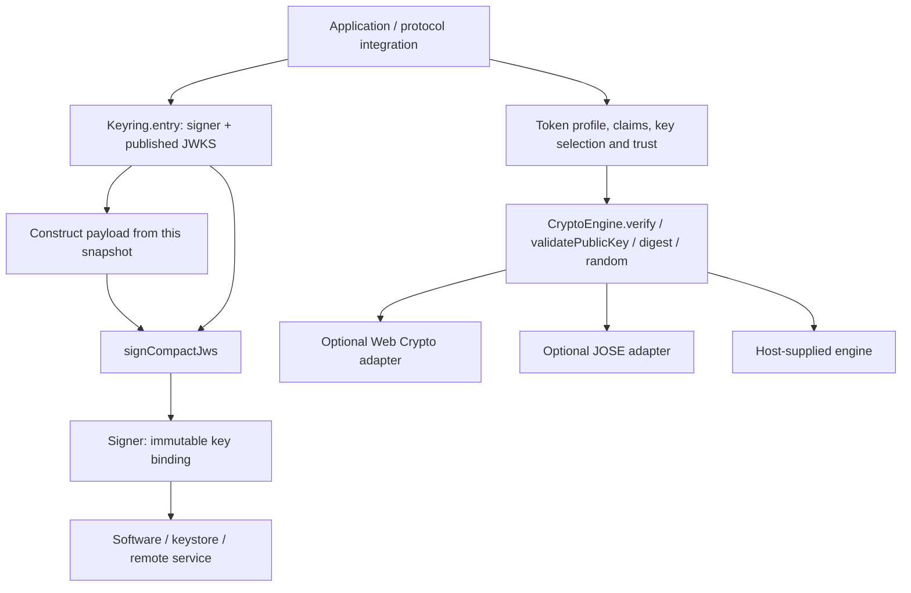

# Crypto

`@oidfed/crypto` separates public cryptographic operations from private-key custody. The [package guide](../../../packages/crypto/README.md) provides installation, signing and rotation examples. Federation hosts receive these contracts explicitly; the [migration guide](../migration-v3.md#host-provided-crypto) covers their configuration.



## Contracts

| Export | Contract |
| --- | --- |
| `CryptoEngine` | Readonly `algorithms`; async `verify(JwsVerifyInput)`, `validatePublicKey(PublicJwk, JwsAlgorithm)`, `digest(DigestAlgorithm, bytes)`, `random(byteLength)` |
| `JwsVerifyInput` | Algorithm, caller-selected public key, exact original ASCII signing input and signature bytes; no compact-token field |
| `Signer` | Readonly `SigningPublicJwk` and async `sign(signingInput): Uint8Array`; operation is permanently bound to that identity |
| `Keyring` / `KeyringEntry` | `entry(purpose, context?)` returns a detached frozen signer identity and published JWKS together |
| `RotatingKeyring` | Keyring plus `publish`, `activate`, `retire`, `revoke`, `history` |
| `KeyPurpose` / `KeySelectionContext` | Application-defined purpose names with optional artifact, issuer, subject, Trust Mark type, and string-valued extensions |
| `FederationArtifact` / `FEDERATION_ARTIFACTS` | Typed signing and verification operations used by Federation hosts |
| `HistoricalKeyRecord` | Public signing identity and recorded optional publication, activation, retirement and revocation events |
| `Jwk` / `PublicJwk` | Structural wire representation; identifier optional; runtime validation still required |
| `SigningPublicJwk` | Public JWK with required nonempty `kid` and supported `alg` |
| `JwkSet` | Readonly array of wire JWKs |
| `JwsAlgorithm` / `BuiltinJwsAlgorithm` | Wire identifier string / identifiers implemented by the bundled adapters |
| `DigestAlgorithm` | SHA-256, SHA-384, SHA-512 |

`CryptoEngine.verify` returns `false` for signature failure and rejects unsupported operations or backend errors. Adapter outputs are checked at runtime. Hosts using a custom engine must also enforce the boolean return contract. Keyrings cannot make a mutable external key alias safe; the host's `Signer` must preserve the captured identity.

## Root operations

| Export | Behavior |
| --- | --- |
| `decodeCompactJws(compact, options?)` | Decode encoded JSON header/payload objects into `DecodedCompactJws`; preserve the original string; do not interpret algorithms, critical headers or signature contents |
| `parseCompactJws(compact, options?)` | Strict canonical base64url and fatal UTF-8 decoding; requires JSON header/payload objects and a nonempty signature; returns `ParsedCompactJws` with unverified data |
| `signCompactJws(payload, header, signer, options?)` | Captures JSON serialization once, pins header alg/kid to signer identity, signs captured bytes and checks signature width |
| `ProtectedHeader` / `CompactJwsOptions` | Supported algorithm and extension header values; optional positive safe-integer `maxBytes` and application `algorithmRegistry` |
| `DEFAULT_MAX_COMPACT_JWS_BYTES` | 512 KiB default limit for signing, inspection and strict parsing |
| `assertSupportedHeader(header, registry?)` | Asymmetric algorithm and header shape checks; supports only critical `b64:true`; rejects `b64:false`, unknown critical headers and b64 without crit |
| `assertVerificationKey(key, algorithm, registry?)` | Checks public-only key material, alg/use/key_ops agreement, supported curve widths and RSA strength; returns the validated input |
| `assertSigningPublicJwk(key, registry?)` | Verification-key checks plus required identifier and algorithm |
| `toPublicJwk(key, registry?)` | Detached allowlist copy of public fields; removes private and unknown fields; does not establish key validity or trust |
| `jwkThumbprint(engine, key, registry?)` | RFC 7638 canonical public members, SHA-256 digest bytes; encode using `encodeBase64url` when a string is needed |
| `signatureByteLength(key, algorithm, registry?)` | Expected JWS signature width for validated key material |
| `encodeBase64url` / `decodeBase64url` | Unpadded canonical codec; rejects malformed encodings and nonzero trailing bits |
| `utf8Encode` / `utf8Decode` | Portable UTF-8; lone surrogates encode as U+FFFD; decoding rejects malformed bytes and omits one leading BOM; invalid inputs throw MALFORMED_JWS |
| `derToJws(signature, algorithm)` / `jwsToDer(signature, algorithm)` | Strict ECDSA conversion; `algorithm` is ES256, ES384 or ES512; reject nonminimal or negative DER integers, bad lengths and trailing data |
| `StaticKeyring(config)` | Configured signers, explicit aliases, optional additional public keys; unique published kids |
| `MemoryRotatingKeyring(initial?, options?)` | General-purpose lifecycle with immutable snapshots and an optional `nowSeconds` clock |
| `JWS_ALGORITHMS`, `CLASSICAL_ALGORITHMS`, `INTEROP_RECOMMENDED_ALGORITHMS`, `isJwsAlgorithm` | Frozen capability/guidance lists and an identifier guard |
| `CompactJwsSizeError` | A `CryptoError` thrown when a compact JWS exceeds its byte limit. Its code remains `MALFORMED_JWS`. |
| `CryptoError`, `CryptoUnsupportedError`, `CryptoErrorCode` | Typed error codes and optional causes; adapters share the root error class within each module format |

`StaticKeyringConfig` and `MemoryRotatingKeyringOptions` describe constructor options. `publishedAt` is the recorded introduction into a memory keyring, including initial keys, and remains unchanged across later lifecycle events. Custom histories may omit it. It is distinct from creation time and confirmed network propagation.

The inspection decoder requires three segments and canonical base64url UTF-8 JSON objects for header and payload. Its signature segment may be empty or malformed: inspection does not establish signing validity. Both decode paths enforce their configured UTF-8 byte-size bound.

Empty keyring maps are valid; an unknown purpose rejects. Additional published keys are validated public asymmetric signing keys with identifiers. Lifecycle key identifiers cannot be reused, including after retirement/revocation. Repeating retirement/revocation preserves its first recorded result. Retiring an active signer is rejected; activate a replacement or revoke the key.

RSA validation requires a minimally encoded modulus of at least 2048 bits and an odd exponent of at least three. EC/OKP validation checks representation and algorithm agreement; the adapters check NIST EC public-point membership before native import, and the backend performs cryptographic operations. Ed25519 and EdDSA both require OKP/Ed25519 material. ECDSA representation conversion validates encoding, not signature correctness. These helpers neither fetch nor authenticate x509 metadata.

## Register a custom JWS algorithm

`createJwsAlgorithmRegistry({ algorithms, keyTypes })` returns an immutable registry that includes the built-ins. Algorithm definitions select a registered public JWK type, validate compatibility with that type, and declare a signature format. A fixed format declares `signature.byteLength` as a number or a function of the key. A variable format declares `signature.minBytes`, `signature.maxBytes`, and a validator for the exact bytes. Key-type definitions list approved public string members and the subset used in RFC 7638 thumbprints. The registry adds the common JWK metadata fields and `kty`.

Pass the registry to host crypto, standalone operations and any built-in keyring selecting those keys. The engine advertises verification capabilities and the signer binds one algorithm to a private key operation. Use the [complete adapter example](../../examples/custom-crypto.ts) to see how both can use a private-use algorithm and key format alongside built-in support.

## Optional backends

The bundled Web Crypto and JOSE verification adapters support `RS384` and `RS512` when explicitly enabled. Both use RSA PKCS#1 v1.5, with SHA-384 or SHA-512 respectively. The default allowlist still has seven algorithms. To accept either new algorithm for Federation signatures, include it in both the engine's capabilities and `allowedFederationAlgorithms`.

<!-- oidfed-example -->
```ts
import { createWebCryptoEngine } from "@oidfed/crypto/web";
import type { FederationOptions } from "@oidfed/core";

const algorithms = ["ES256", "RS384", "RS512"] as const;
export const options: FederationOptions = {
  engine: createWebCryptoEngine(undefined, { algorithms }),
  allowedFederationAlgorithms: algorithms,
};
```

`@oidfed/crypto/web` exports `createWebCryptoEngine(implementation?, options?)`, `SoftwareSigner`, `WebCryptoEngineOptions`, `WebCryptoLike` and `WebCryptoAlgorithm`. `SoftwareSigner` takes a private JWK with `kid`/`alg`, optionally an injected Web Crypto implementation; its public property contains only public key metadata. Concurrent calls share the import. Success releases its private JWK copy and a failed import can be retried. Web Crypto algorithms may be restricted using `options.algorithms`. Unavailable runtime algorithms reject with a typed unsupported error when used. Random generation splits requests into Web Crypto's 65,536-byte chunks.

`@oidfed/crypto/jose` exports `createJoseEngine(implementation?, options?)`, using the same capability options. Import this entry only when `jose` v6 is installed. The adapter's verification backend is JOSE's global Web Crypto; injected Web Crypto supplies digest/random.

## Standards and boundaries

Encoding follows [RFC 7515](https://www.rfc-editor.org/rfc/rfc7515), asymmetric key representations follow [RFC 7518](https://www.rfc-editor.org/rfc/rfc7518), thumbprints follow [RFC 7638](https://www.rfc-editor.org/rfc/rfc7638), and encoded-payload handling follows [RFC 7797](https://www.rfc-editor.org/rfc/rfc7797). The package accepts the fully specified Ed25519 identifier from [RFC 9864](https://www.rfc-editor.org/rfc/rfc9864) and retains EdDSA for compatibility.

The [migration guide](../migration-v3.md#host-provided-crypto) describes host integration and the boundaries protocol code must preserve.

Signature verification does not validate JWT NumericDates, audience, issuer, subject, token type, trust chain or key provenance. Protocol code supplies those rules, including its handling of missing/duplicate key identifiers. Never use parsed claims or embedded JWKS as trusted input merely because they were decoded.

The optional adapters check NIST EC public-point membership consistently across runtimes before native import. Curve parameters follow [NIST SP 800-186](https://csrc.nist.gov/pubs/sp/800/186/final), with public-point validation as described in [SEC 1](https://www.secg.org/sec1-v2.pdf). This concerns public-key validation; cryptographic signing and signature verification remain backend operations.
