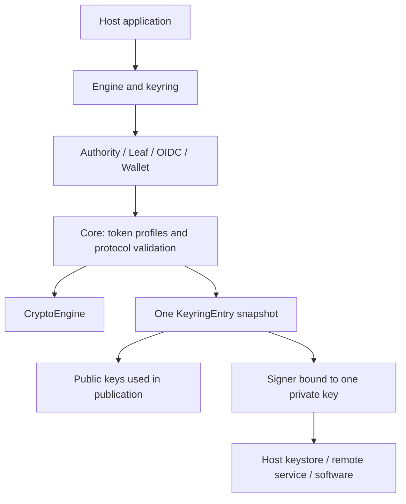

# Using host-provided crypto

Federation hosts now take an explicit engine and keyring. Core checks token profiles and protocol claims; the engine performs cryptographic operations, and the selected signer owns the private-key operation. Installing a library does not select a backend.

This is a breaking API change for core, authority, leaf, OIDC and wallet. The previous full-token signer and federation/protocol key-provider APIs have been removed.

The main API replacements are:

| Previous API | Current API |
| --- | --- |
| Full-token signer | `Signer.sign(bytes)`, consumed through `KeyringEntry` |
| Federation and protocol providers | `CryptoContext` and explicit role signing purposes |
| Synchronous host constructor | `await Leaf.create`, `TrustAnchor.create`, `Intermediate.create` |
| Core key generation | Application/backend setup or CLI `keygen` |
| `SUPPORTED_ALGORITHMS` | `DEFAULT_ALLOWED_ALGORITHMS`; engine capability remains separate |
| `REQUIRED_ALGORITHMS` | `INTEROP_RECOMMENDED_ALGORITHMS`, currently RS256 guidance |
| Automatic overlap and retirement constant | Explicit host scheduling of `keyring.retire` |



## Configure a host

Install `@oidfed/crypto` as a direct application dependency when importing its contracts or adapters. Choose the backend in your application. The Web Crypto adapter is convenient when your runtime already provides Web Crypto:

```ts
import { StaticKeyring } from "@oidfed/crypto";
import { createWebCryptoEngine } from "@oidfed/crypto/web";
import { Leaf } from "@oidfed/leaf";

// federationSigner implements Signer and retains its own private-key handle.
const engine = createWebCryptoEngine();
const keyring = new StaticKeyring({ signers: { federation: federationSigner } });
const leaf = await Leaf.create({
  entityId: "https://member.example",
  authorityHints: ["https://anchor.example"],
  crypto: { engine, keyring },
  metadata: { federation_entity: { organization_name: "Example member" } },
});
```

Use `await TrustAnchor.create(...)` or `await Intermediate.create(...)` for authorities. Their factories also await role initialization and validate required signing purposes. Authorities using the built-in memory storage configure its engine explicitly: `new MemoryStorageAdapter({ engine })`.

`SoftwareSigner` from `@oidfed/crypto/web` accepts a private JWK for applications that choose software custody. Key generation belongs to application/backend setup; core no longer generates keys. The CLI's `keygen` and `sign` commands continue to provide software-key workflows.

For a custom engine, implement `algorithms`, `verify`, `validatePublicKey`, `digest` and `random`. Verification receives the original JWS bytes and returns a literal boolean. Public-key validation checks whether that backend can use the designated key, without verifying claims or proving possession. Digests and randomness return fresh byte arrays of the requested size.

A signer publishes its public identity and accepts raw JWS signing bytes. ECDSA signatures use fixed-width `R || S`; convert a backend's DER signature before returning it. Capture an immutable private-key handle. Resolving a mutable “current key” alias inside `sign()` would break the snapshot contract.

React Native applications implement these same contracts with their chosen native crypto and custody APIs. No Credo version, React Native provider or crypto global is required by the libraries. The application still supplies the transport APIs used by its selected features.

## Separate federation and protocol purposes

Federation Entity Keys appear in the Entity Configuration's top-level `jwks`. Protocol signing keys belong inside the corresponding role metadata.

```ts
import { OidcRelyingPartyRole } from "@oidfed/oidc";

const keyring = new StaticKeyring({
  signers: {
    federation: federationSigner,
    request_object: protocolSigner,
  },
  aliases: { client_assertion: "request_object" },
});
const rp = new OidcRelyingPartyRole({
  metadata: {
    redirect_uris: ["https://member.example/callback"],
    client_registration_types: ["automatic", "explicit"],
  },
  signing: {
    requestObject: "request_object",
    clientAssertion: "client_assertion",
  },
});
```

Attach `rp` through the host's `roles` configuration. The host derives this role's inline JWKS from the configured purposes whenever it rebuilds its Entity Configuration. Do not also supply `jwks`, `jwks_uri` or `signed_jwks_uri` for a role whose publication the library manages. Metadata supplied for an external protocol implementation remains application owned.

Wallet Provider instance issuance uses `signing.walletAttestation`; Credential Verifier instance request creation uses `signing.authorizationRequest`. Configure only the operations that the role performs. Metadata-only roles need no local signing purposes. Standalone helpers and holder-key proofs accept an explicit `KeyringEntry`.

An omitted purpose has no fallback. Configure an alias when two operations deliberately share a key. Selection context carries issuer, subject and trust-mark type so custom keyrings can select keys without depending on an application framework.

## Verify tokens and bind policy

Standalone verification receives an engine and authenticated public keys:

```ts
import { verifyEntityStatement } from "@oidfed/core";

const result = await verifyEntityStatement(jwt, trustedJwks, { engine });
if (!result.ok) throw new Error(result.error.description);
```

Verification needs no keyring or private key. Instance methods inherit their host's engine. Host, role and call options combine in that order; accepted algorithm lists intersect, and resource ceilings take the smallest configured value.

`allowedFederationAlgorithms` applies to signing and verification with Federation Entity Keys. Its default is ES256, ES384, ES512, PS256, PS384, PS512, and RS256. An explicitly narrower list on a role or operation stays within the host's ceiling. Use `allowedFederationAlgorithms: ["RS256"]` to require RS256 for federation artifacts and federation endpoint assertions while continuing to use ES256 in an OIDC role. Move earlier `allowedAlgorithms` settings for Federation Entity Keys to `allowedFederationAlgorithms`. Keep protocol-specific restrictions in the relevant protocol options.

Algorithm permission and backend capability are checked separately. Verification requires a capable engine. Signing uses the configured signer. Ed25519 and its legacy EdDSA identifier require explicit policy. For a custom algorithm, use the same `algorithmRegistry` on the crypto context and keyring, and add the identifier to the allowlist for the intended operation. See the [custom profile example](../../examples/custom-crypto.ts).

Core's `JwsService` applies a per-token profile: expected or absent `typ`, key identifier rules, audience and time validation. Federation tokens remain strict; kid-less single-key protocol tokens and duplicate protocol identifiers retain their protocol-specific handling. For federation client assertions and single-key Request Objects, an omitted `kid` is accepted only when the entire published JWKS contains one key. A supplied `kid` must match. A wallet proof backed by a single confirmed, unlabeled key has its own verification profile. The default verification budget is 16 eligible candidates, which is a resource policy rather than a limit on published JWKS size.

Set `maxCompactBytes` for the encoded token at signing, inspection and verification. The default is 512 KiB. Remote responses also require a sufficient `maxResponseBytes` transport allowance.

Use `decodeCompactJws` or core's decode helpers for unverified inspection. They can inspect unknown algorithms. `parseCompactJws` applies supported JWS syntax before verification. Neither decoder authenticates claims.

For a custom token family, choose its profile explicitly:

```ts
import { JwsService } from "@oidfed/core";

const tokens = new JwsService({ engine, allowedAlgorithms: ["ES256"] });
const checked = await tokens.verifyJwt(jwt, trustedJwks, {
  typ: { expected: "example+jwt" },
  keyId: "allow-single-key",
  audience: { expected: "https://recipient.example", mode: "only" },
});
```

A signature mismatch, malformed key, unsupported operation and backend outage are distinct failures. Core never treats a thrown operation or a truthy non-boolean result as successful verification. Public HTTP responses omit backend error details.

## Publish and retire keys deliberately

Read one entry before constructing a payload that advertises its keys. Use `entry.publishedJwks` and sign with that entry's signer. Hosts and managed roles follow this rule. Wallet issuance with an attached trust chain checks the selected signer against its authenticated effective protocol JWKS, including superior overrides. When issuing without an attached chain, the application publishes the selected protocol key.

For rotation, the host publishes the next key, waits for propagation, activates it, then schedules retirement after the required overlap. To reproduce the former seven-day default, schedule `keyring.retire(purpose, previousKid)` for seven days after activation. Use your application's durable scheduler; the library does not run retirement timers.

Configure historical-key features explicitly:

```ts
import { historicalKeysFromKeyring } from "@oidfed/core";

const crypto = {
  engine,
  keyring,
  history: historicalKeysFromKeyring(keyring),
};
```

The conversion publishes withdrawn keys, records expiration from retirement/revocation and preserves earlier retirement when revocation is recorded later. It does not invent key issuance or validity-start times from publication or signing activation. A custom history source may supply those facts when known. A historical-keys endpoint requires a history source; other authorities can use a basic keyring.

Revocation changes future selection and publication. Previously captured entries retain their signing callbacks. Applications control backend revocation or cancellation when an existing handle must stop working.

Cache-key helpers now receive an engine. `MemoryReplayStore` also requires `{ engine }`; replay deadlines, capacity handling and digest formats remain part of its contract.

The package isolation checks exercise packed ESM and CommonJS consumers without JOSE or host crypto/encoding/cloning globals. Native keystore and bundler integration should also be checked in the consuming application.
