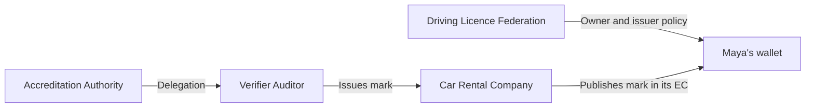

# 6. Trust Marks

**Car Rental Company** receives accreditation after the **Verifier Auditor** reviews its practices. The signed **Trust Mark** is evidence that consumers can evaluate against their configured trust framework. [Federation §7; endpoints in §8.4–§8.6](https://openid.net/specs/openid-federation-1_0.html#section-7).

An issuer uses its host's Trust Mark methods; a holder attaches validated marks to its host's publication. OIDC and Wallet operations evaluate published marks through configured issuer trust. Core supplies remote Status/Listing clients and standalone verification when no host operation covers that task.

## Example context

Meet the driving licence participants

The example **Driving Licence Federation** operates a **Trust Anchor**. The **Licensing Authority** issues **Maya**'s driving licence. The **Wallet Provider** supplies her wallet solution and attests her wallet instance. The **Car Rental Company** requests a presentation and verifies it before making a rental decision.

An **Accreditation Authority** owns an example approved-verifier Trust Mark type. A **Verifier Auditor** can issue that mark under its delegation and the anchor's policy. The rental company holds the mark. These organizational roles are separate from Maya and her wallet instance.

This is an illustrative application of [Wallet Draft 05's model](https://openid.net/specs/openid-federation-wallet-1_0-05.html#section-4). The names, accreditation policy, and `.example` addresses describe this documentation's example, not a prescribed licence scheme. [Example identifiers](README.md#example-entity-identifiers) are listed in the index.

## Walk through accreditation

The **council** defines the accreditation framework and authorizes the **Verifier Auditor** through the required delegation. Driving Licence Federation publishes the owner and issuer policy its consumers use. These administrative decisions do not automatically issue a mark for Car Rental Company.

The auditor assesses Car Rental Company, issues the JWT, and delivers it through an agreed channel. Car Rental Company validates the received evidence and attaches the mark to its Entity Configuration. A wallet later validates Car Rental Company's chain, establishes trust in the auditor, and checks the mark and any required current status before relying on the accreditation.

Keep the renewal and withdrawal paths explicit. The auditor renews or revokes records; the holder updates its published references; consumers refresh evidence and apply their freshness policy. No participant can erase already-distributed signed bytes. The next decision must be based on the applicable lifetimes, delegation, and current-state checks.

## Work through this topic

Start with owner and issuer policy, then follow issuance, delivery, publication, verification, and maintenance. Accreditation decisions and delegation delivery use arrangements outside the federation protocol.

- [6.1. Declare Trust Mark owners and accepted issuers](6.1.trust-mark-policy.md)
- [6.2. Issue a Trust Mark after accreditation](6.2.trust-mark-issuance.md)
- [6.3. Delegate Trust Mark issuance](6.3.trust-mark-delegation.md)
- [6.4. Validate accreditation before relying on it](6.4.trust-mark-validation.md)
- [6.5. Publish a received Trust Mark in an EC](6.5.trust-mark-publication.md)
- [6.6. Check the status of an exact Trust Mark JWT](6.6.trust-mark-status.md)
- [6.7. Check whether a subject is currently listed for a mark type](6.7.trust-mark-listing.md)
- [6.8. Retrieve a subject’s Trust Mark](6.8.trust-mark-retrieval.md)
- [6.9. Renew or revoke accreditation](6.9.trust-mark-lifecycle.md)
- [6.10. Verify older Trust Mark signatures after rotation](6.10.trust-mark-historical-keys.md)
- [6.11. Display Trust Mark information safely](6.11.trust-mark-display.md)

> [!IMPORTANT]
> Accreditation assessment and delegation delivery use the parties’ agreed channels. Issuer discovery is an explicit client option; a valid holder chain alone does not establish accreditation.

## Operating accreditation through Trust Marks

The framework decides what accreditation means and who may issue it. Configure issuer acceptance and owner keys from trusted sources. A declared owner supplies a signed delegation to the issuer outside Federation; the same requirement applies when owner and issuer are the same entity. Assessment, approval, delegation delivery, and operator authorization for administrative APIs belong to the host. A dashboard can accept a delivered JWT, but it must validate it before publishing or relying on it.

Choose whether to verify issuer trust through Federation anchors or explicit out-of-band accreditation. Preserve the original mark and authenticated claims for decisions, and honor `verificationExpiresAt` when reusing evidence. Key rotation may require authenticated historical keys; it does not justify accepting compromised keys or extending a mark's validity.

Decide how quickly revocation must become visible. Status checks disclose the exact JWT to its issuer. Type-only listing avoids sending the subject, while a filtered listing is smaller and discloses it. Listing membership can survive replacement of an individual JWT. Short-lived marks are another choice in Federation §19.2. No API can erase evidence already cached remotely before its applicable deadline.

Protect issuance, renewal, revocation, and policy-update methods as administrative operations. The Trust Mark retrieval endpoint only retrieves eligible stored accreditation; a public request does not authorize new issuance. Use durable transactions and consistent reads for multi-process issuers, and supply verified transport facts when implementing a custom client-authentication method.

[Next: 6.1. Declare Trust Mark owners and accepted issuers](6.1.trust-mark-policy.md)
