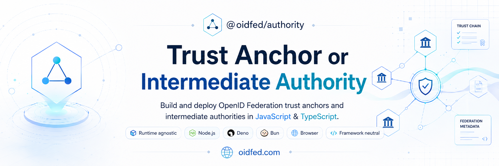

# @oidfed/authority

<p align="center">
  <a href="https://www.npmjs.com/package/@oidfed/authority"></a>
  <a href="https://www.npmjs.com/package/@oidfed/authority"></a>
  <a href="https://github.com/Dahkenangnon/oidfed/blob/main/packages/authority/LICENSE"></a>
  <a href="https://packagephobia.com/result?p=@oidfed/authority"></a>
  <a href="https://github.com/Dahkenangnon/oidfed/blob/main/scripts/coverage-check.sh"></a>
</p>

<div align="center">
  
</div>

<p align="center">
  <a href="https://www.npmjs.com/package/@oidfed/core">@oidfed/core</a> &nbsp;•&nbsp;
  <b>@oidfed/authority</b> &nbsp;•&nbsp;
  <a href="https://www.npmjs.com/package/@oidfed/leaf">@oidfed/leaf</a> &nbsp;•&nbsp;
  <a href="https://www.npmjs.com/package/@oidfed/oidc">@oidfed/oidc</a> &nbsp;•&nbsp;
  <a href="https://www.npmjs.com/package/@oidfed/wallet">@oidfed/wallet</a> &nbsp;•&nbsp;
  <a href="https://www.npmjs.com/package/@oidfed/cli">@oidfed/cli</a>
</p>

Trust Anchor and Intermediate Authority operations — subordinate management, statement issuance, federation endpoint serving, and policy enforcement for OpenID Federation 1.0 deployments.

Targets the final [OpenID Federation 1.0](https://openid.net/specs/openid-federation-1_0.html) specification and its successor specifications:
* [OpenID Federation 1.1](https://openid.net/specs/openid-federation-1_1.html) (protocol-independent layer)
* [OpenID Federation for OpenID Connect 1.1](https://openid.net/specs/openid-federation-connect-1_1.html) (protocol-specific layer)
* [Extended Subordinate Listing, Draft 03](https://openid.net/specs/openid-federation-extended-listing-1_0-03.html)
* [Subordinate Events, Draft 01](https://openid.net/specs/openid-federation-subordinate-events-1_0-01.html)
* [Entity Collection, Draft 01](https://openid.net/specs/openid-federation-entity-collection-1_0-01.html)

## Install

Choose the command for your preferred JavaScript package manager or runtime:

```bash
# npm
npm install @oidfed/authority

# pnpm
pnpm add @oidfed/authority

# yarn
yarn add @oidfed/authority

# bun
bun add @oidfed/authority

# Deno (Deno 2.0+ / JSR/npm specifier auto-resolution)
deno add npm:@oidfed/authority
```

The quick start also imports `@oidfed/crypto`. Add it as a direct dependency to use its keyring and Web Crypto adapter.

## Quick Start

```ts
import { StaticKeyring, type Signer } from "@oidfed/crypto";
import { createWebCryptoEngine } from "@oidfed/crypto/web";
import { MemoryStorageAdapter, TrustAnchor } from "@oidfed/authority";

export async function createAuthority(federationSigner: Signer) {
  const engine = createWebCryptoEngine(); // Choose or inject a backend in the application.
  const authority = await TrustAnchor.create({
    entityId: "https://ta.example.org",
    crypto: { engine, keyring: new StaticKeyring({ signers: { federation: federationSigner } }) },
    storage: new MemoryStorageAdapter({ engine }),
    metadata: { federation_entity: {
      federation_fetch_endpoint: "https://ta.example.org/federation_fetch",
      federation_list_endpoint: "https://ta.example.org/federation_list",
    } },
  });
  return { authority, handleRequest: (request: Request) => authority.handleRequest(request) };
}
```

A basic keyring is enough for authority signing. Configure `crypto.history` when exposing historical-key features; `historicalKeysFromKeyring` in core converts a rotating keyring's recorded events. The host schedules propagation and retirement. See the [crypto migration guide](../../docs/api/crypto/migration.md).

Federation endpoint `private_key_jwt` authentication uses `AuthorityConfig.clientKeyProvider`
to resolve a caller's public Federation Entity Keys. Omit it to use the default
subordinate-storage lookup: `storage.subordinates.get(entityId)?.jwks`.
Authenticated federation endpoints require `storage.replay`. Claims are checked and
atomically recorded before the endpoint runs; production processes serving the same
authority must share replay state.

Authorities can publish signed subordinate histories through the optional
[Subordinate Events endpoint](https://github.com/Dahkenangnon/oidfed/blob/main/docs/features/13.1.subordinate-events.md#lifecycle-recording-and-endpoint-responses).
Compose [wallet roles](https://github.com/Dahkenangnon/oidfed/blob/main/docs/api/wallet/README.md)
when an authority also acts as a Wallet Provider, Credential Issuer, or Verifier.

HTTP routes follow the URLs advertised in `metadata.federation_entity`. The
Entity Configuration route is derived from the configured Entity Identifier path,
and fetch/list/optional federation endpoints are served on the advertised
endpoint URL paths.

## Entity Collection

Trust Anchors and Intermediates can serve Draft 01 collections through the shared core service. Refresh snapshots explicitly, then query them with filters, informational claims, language selection, and pagination. See the [Entity Collection guide](https://github.com/Dahkenangnon/oidfed/blob/main/docs/features/14.2.collection-operations.md) for configuration and endpoint integration.

## Documentation

For a detailed API reference, subordinate management APIs, and unified storage adapter setups, see the [authority API reference](https://github.com/Dahkenangnon/oidfed/blob/main/docs/api/authority/README.md) file.

## License

[Apache-2.0](LICENSE) — see [`NOTICE`](NOTICE) for attribution.
