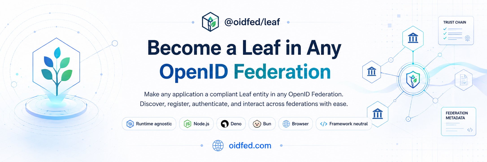

# @oidfed/leaf

<p align="center">
  <a href="https://www.npmjs.com/package/@oidfed/leaf"></a>
  <a href="https://www.npmjs.com/package/@oidfed/leaf"></a>
  <a href="https://github.com/Dahkenangnon/oidfed/blob/main/packages/leaf/LICENSE"></a>
  <a href="https://packagephobia.com/result?p=@oidfed/leaf"></a>
  <a href="https://github.com/Dahkenangnon/oidfed/blob/main/scripts/coverage-check.sh"></a>
</p>

<div align="center">
  
</div>

<p align="center">
  <a href="https://www.npmjs.com/package/@oidfed/core">@oidfed/core</a> &nbsp;•&nbsp;
  <a href="https://www.npmjs.com/package/@oidfed/authority">@oidfed/authority</a> &nbsp;•&nbsp;
  <b>@oidfed/leaf</b> &nbsp;•&nbsp;
  <a href="https://www.npmjs.com/package/@oidfed/oidc">@oidfed/oidc</a> &nbsp;•&nbsp;
  <a href="https://www.npmjs.com/package/@oidfed/wallet">@oidfed/wallet</a> &nbsp;•&nbsp;
  <a href="https://www.npmjs.com/package/@oidfed/cli">@oidfed/cli</a>
</p>

Leaf Entity toolkit — Entity Configuration serving, authority discovery, and trust chain participation for any entity at the edge of an OpenID Federation.

Targets the final [OpenID Federation 1.0](https://openid.net/specs/openid-federation-1_0.html) specification and its successor specifications:
* [OpenID Federation 1.1](https://openid.net/specs/openid-federation-1_1.html) (protocol-independent layer)
* [OpenID Federation for OpenID Connect 1.1](https://openid.net/specs/openid-federation-connect-1_1.html) (protocol-specific layer)

## Install

Choose the command for your preferred JavaScript package manager or runtime:

```bash
# npm
npm install @oidfed/leaf

# pnpm
pnpm add @oidfed/leaf

# yarn
yarn add @oidfed/leaf

# bun
bun add @oidfed/leaf

# Deno (Deno 2.0+ / JSR/npm specifier auto-resolution)
deno add npm:@oidfed/leaf
```

For the OIDC quick start below, also install `@oidfed/oidc` and `@oidfed/crypto`.

## Quick Start

```ts
import { StaticKeyring, type Signer } from "@oidfed/crypto";
import { createWebCryptoEngine } from "@oidfed/crypto/web";
import { Leaf } from "@oidfed/leaf";
import { OidcRelyingPartyRole } from "@oidfed/oidc";

export async function createRelyingParty(federationSigner: Signer, protocolSigner: Signer) {
  const engine = createWebCryptoEngine(); // The application chooses its backend.
  const keyring = new StaticKeyring({
    signers: { federation: federationSigner, request_object: protocolSigner },
    aliases: { client_assertion: "request_object" },
  });
  const rp = new OidcRelyingPartyRole({
    signing: { requestObject: "request_object", clientAssertion: "client_assertion" },
    metadata: {
      redirect_uris: ["https://rp.example.com/callback"],
      response_types: ["code"],
      client_registration_types: ["automatic", "explicit"],
    },
  });
  const leaf = await Leaf.create({
    entityId: "https://rp.example.com",
    authorityHints: ["https://ta.example.org"],
    crypto: { engine, keyring },
    metadata: { federation_entity: { organization_name: "Example RP" } },
    roles: [rp],
  });
  return { leaf, rp, handleRequest: (request: Request) => leaf.handleRequest(request) };
}
```

The application supplies stable signers and chooses its engine. The host derives managed protocol JWKS from the configured purpose snapshots. `SoftwareSigner` from `@oidfed/crypto/web` is available for software custody; custom signers can retain native or remote key handles. See the [crypto migration guide](../../docs/api/crypto/migration.md).

Leaves can compose [wallet roles](https://github.com/Dahkenangnon/oidfed/blob/main/docs/api/wallet/README.md) for Wallet Providers, Credential Issuers, and Credential Verifiers.

## Entity Collection

Leaves can serve Draft 01 collections through the shared core service. It supports explicit snapshot refresh, filters, informational metadata, language selection, and pagination. See the [Entity Collection guide](https://github.com/Dahkenangnon/oidfed/blob/main/docs/features/14.2.collection-operations.md) for configuration and endpoint integration.

## Documentation

See the [leaf API reference](https://github.com/Dahkenangnon/oidfed/blob/main/docs/api/leaf/README.md) for public constructors, methods, and configuration contracts.

## License

[Apache-2.0](LICENSE) — see [`NOTICE`](NOTICE) for attribution.
