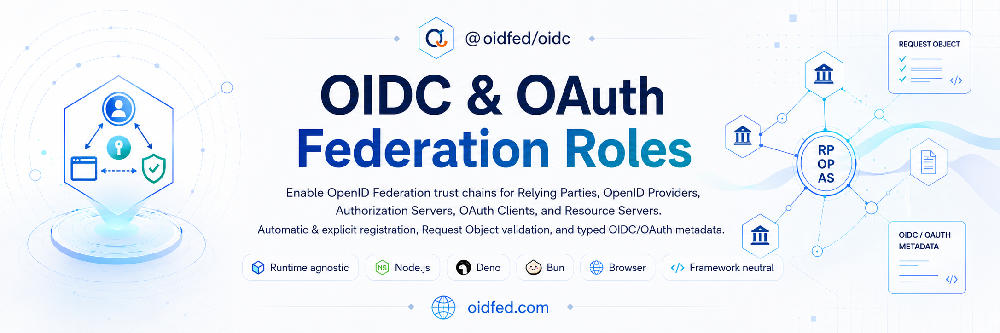

# @oidfed/oidc

<p align="center">
  <a href="https://www.npmjs.com/package/@oidfed/oidc"></a>
  <a href="https://www.npmjs.com/package/@oidfed/oidc"></a>
  <a href="https://github.com/Dahkenangnon/oidfed/blob/main/packages/oidc/LICENSE"></a>
  <a href="https://packagephobia.com/result?p=@oidfed/oidc"></a>
  <a href="https://github.com/Dahkenangnon/oidfed/blob/main/scripts/coverage-check.sh"></a>
</p>

<div align="center">
  
</div>

<p align="center">
  <a href="https://www.npmjs.com/package/@oidfed/core">@oidfed/core</a> &nbsp;•&nbsp;
  <a href="https://www.npmjs.com/package/@oidfed/authority">@oidfed/authority</a> &nbsp;•&nbsp;
  <a href="https://www.npmjs.com/package/@oidfed/leaf">@oidfed/leaf</a> &nbsp;•&nbsp;
  <b>@oidfed/oidc</b> &nbsp;•&nbsp;
  <a href="https://www.npmjs.com/package/@oidfed/wallet">@oidfed/wallet</a> &nbsp;•&nbsp;
  <a href="https://www.npmjs.com/package/@oidfed/cli">@oidfed/cli</a>
</p>

OpenID Connect and OAuth 2.0 federation flows — automatic and explicit client registration, Request Object validation, and RP/OP metadata processing as defined in OpenID Federation 1.0.

Targets the final [OpenID Federation 1.0](https://openid.net/specs/openid-federation-1_0.html) specification and its successor specifications:
* [OpenID Federation 1.1](https://openid.net/specs/openid-federation-1_1-final.html) (protocol-independent layer)
* [OpenID Federation for OpenID Connect 1.1](https://openid.net/specs/openid-federation-connect-1_1-final.html) (protocol-specific layer)

## Install

Choose the command for your preferred JavaScript package manager or runtime:

```bash
# npm
npm install @oidfed/oidc

# pnpm
pnpm add @oidfed/oidc

# yarn
yarn add @oidfed/oidc

# bun
bun add @oidfed/oidc

# Deno (Deno 2.0+ / JSR/npm specifier auto-resolution)
deno add npm:@oidfed/oidc
```

## Quick Start

This package provides role classes that compose directly with `Leaf`, `TrustAnchor`, or `Intermediate` instances.

Configure federation and protocol keys under separate keyring purposes. RP roles derive their public `jwks` from the purposes used to sign Request Objects and client assertions. For an external OP protocol engine, its key metadata remains application owned. Hosts receive explicit engine and keyring contracts; historical-key features use an optional history source.

The RP example imports `@oidfed/leaf` and `@oidfed/crypto`. The OP example imports `@oidfed/authority` and `@oidfed/core`. Add the dependencies for the example you use.

### RP Composition Example

```ts
import { StaticKeyring, type Signer } from "@oidfed/crypto";
import { createWebCryptoEngine } from "@oidfed/crypto/web";
import { Leaf } from "@oidfed/leaf";
import { OidcRelyingPartyRole } from "@oidfed/oidc";

export async function createRelyingParty(federationSigner: Signer, protocolSigner: Signer) {
  const engine = createWebCryptoEngine(); // The application chooses its backend.
  const keyring = new StaticKeyring({
    signers: { federation: federationSigner, request_object: protocolSigner },
    aliases: { client_assertion: "request_object" },
  });
  const rp = new OidcRelyingPartyRole({
    signing: { requestObject: "request_object", clientAssertion: "client_assertion" },
    metadata: {
      redirect_uris: ["https://rp.example.com/callback"],
      response_types: ["code"],
      client_registration_types: ["automatic", "explicit"],
    },
  });
  const leaf = await Leaf.create({
    entityId: "https://rp.example.com",
    authorityHints: ["https://ta.example.org"],
    crypto: { engine, keyring },
    metadata: { federation_entity: { organization_name: "Example RP" } },
    roles: [rp],
  });
  return { leaf, rp, handleRequest: (request: Request) => leaf.handleRequest(request) };
}
```

### OP Composition Example


This example assumes `opProtocolPublicKeys` contains the OP’s RSA and EC protocol public keys, matching its RS256 and ES256 support. Keep these separate from its Federation Entity Keys.

```ts
import { TrustAnchor } from "@oidfed/authority";
import { OidcProviderRole } from "@oidfed/oidc";
import { createTrustAnchorSet, type CryptoContext, type JWK, type FederationStorage } from "@oidfed/core";

export async function createExampleOp(
  crypto: CryptoContext,
  opProtocolPublicKeys: JWK[],
  storage: FederationStorage,
) {
  const federationKeys = await crypto.keyring.entry(crypto.federationPurpose ?? "federation", {
    issuer: "https://op.example.com", subject: "https://op.example.com",
  });

  const opEntity = await TrustAnchor.create({
    entityId: "https://op.example.com",
    crypto,
    trustAnchors: createTrustAnchorSet([
      {
        entityId: "https://op.example.com",
        jwks: federationKeys.publishedJwks,
      },
    ]),
    storage,
    metadata: {
      federation_entity: {
        federation_fetch_endpoint: "https://op.example.com/federation_fetch",
        federation_list_endpoint: "https://op.example.com/federation_list",
      },
    },
    roles: [
      new OidcProviderRole({
        registrationPath: "/register",
        metadata: {
          issuer: "https://op.example.com",
          authorization_endpoint: "https://op.example.com/auth",
          token_endpoint: "https://op.example.com/token",
          response_types_supported: ["code"],
          subject_types_supported: ["public"],
          id_token_signing_alg_values_supported: ["RS256", "ES256"],
          client_registration_types_supported: ["automatic", "explicit"],
          jwks: { keys: opProtocolPublicKeys },
        },
      })
    ]
  });
  return opEntity;
}
```

## Documentation

See the [OIDC API reference](https://github.com/Dahkenangnon/oidfed/blob/main/docs/api/oidc/README.md) for public roles, registration contracts, protocol signing purposes, and metadata validation methods.

## License

[Apache-2.0](LICENSE) — see [`NOTICE`](NOTICE) for attribution.
