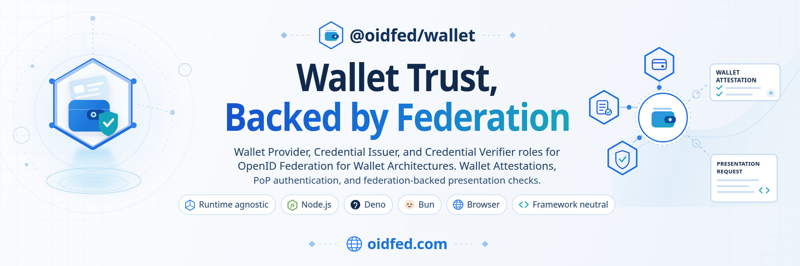

# @oidfed/wallet

  
  
  
  
  

  

  <a href="https://www.npmjs.com/package/@oidfed/core">@oidfed/core</a> &nbsp;•&nbsp;
  <a href="https://www.npmjs.com/package/@oidfed/authority">@oidfed/authority</a> &nbsp;•&nbsp;
  <a href="https://www.npmjs.com/package/@oidfed/leaf">@oidfed/leaf</a> &nbsp;•&nbsp;
  <a href="https://www.npmjs.com/package/@oidfed/oidc">@oidfed/oidc</a> &nbsp;•&nbsp;
  <b>@oidfed/wallet</b> &nbsp;•&nbsp;
  <a href="https://www.npmjs.com/package/@oidfed/cli">@oidfed/cli</a>

Wallet Provider, Credential Issuer, and Credential Verifier roles for [OpenID Federation for Wallet Architectures 1.0, Draft 05](https://openid.net/specs/openid-federation-wallet-1_0-05.html).

Compose roles into `@oidfed/leaf` or `@oidfed/authority`. Wallet applications can use their static discovery and verification methods without a federation identity. Core supplies trust-chain validation, metadata policies, key resolution, and replay storage contracts.

Install `@oidfed/wallet` for standalone wallet operations. To attach a wallet role to a Leaf, run `pnpm add @oidfed/leaf @oidfed/wallet`.

The package supports JWT Wallet Attestations, proof-of-possession authentication, federation-backed Request Object checks, supplied chains, offline validation, and credential-format integrations. Your VCI/VP engine owns protocol endpoints, sessions, credential selection, and presentation processing.

See the [wallet API reference](../../docs/api/wallet/README.md) for public roles, signatures, validation contracts, and usage examples.

For mobile app setup, see [React Native compatibility](https://github.com/Dahkenangnon/oidfed/blob/main/docs/api/react-native.md).

All three roles expose `parsePublicationMetadata()` for partial publications and `parseMetadata()` for completed effective metadata. Matching `*PublicationMetadata` types are available from the package entrypoint; see the [metadata reference](../../docs/api/wallet/wallet.md#walletprovidermetadata).
